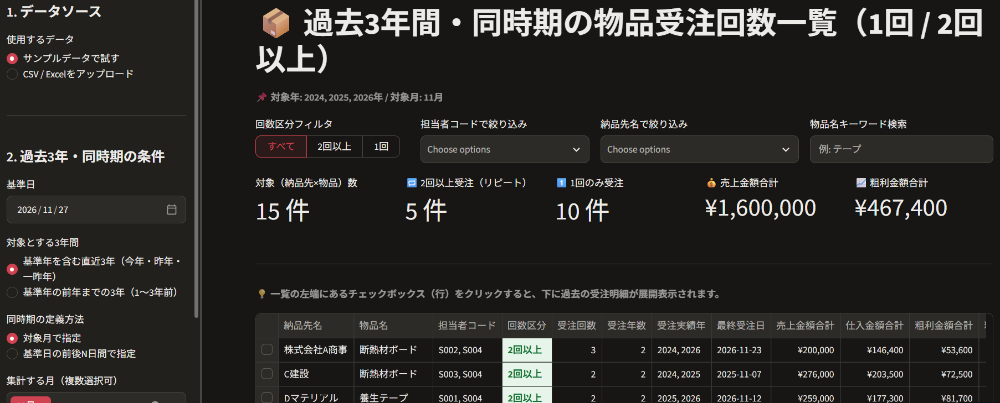

# 📦 過去3年間・同時期の物品受注回数一覧アプリ

過去の受注履歴データから**「毎年同じ時期に発注されているリピート商材」**と**「単発受注の商材」**を自動判定し、売上・粗利とあわせて可視化する営業支援Webアプリです。

## 🚀 アプリの試用URL

以下のリンクから、ブラウザ上で今すぐアプリを試用できます（サンプルデータ内蔵のため、ファイルを用意しなくてもそのまま動作確認が可能です）。

👉 [**アプリを試用する（Streamlit Community Cloud）**](https://your-app-url.streamlit.app/)

## 📖 アプリの機能概要

受注データ（受注年月日・物品名・納品先名・担当者コード・売上金額・仕入金額）を取り込み、過去3年間の「同時期」に絞って納品先と物品の組み合わせごとに受注実績を集計します。

* **同時期の柔軟な抽出:** 「対象月（複数選択可）」または「基準日の前後N日間」で期間を自在に指定可能（うるう年も自動対応）。
* **リピート自動判定（1回 / 2回以上）:** 同時期の受注回数に応じて「2回以上（リピート）」と「1回のみ」を自動分類し、見やすく色分け表示。
* **売上・粗利の自動算出:** 納品先×物品ごとの売上合計・仕入合計・粗利金額・粗利率（%）を一目で把握。
* **多彩な絞り込み検索:** 回数区分・担当者コード・納品先名・物品名キーワードでターゲットを即座にフィルタリング。
* **ワンクリックで受注明細を展開:** 一覧の行を選択すると、画面下部に過去の具体的な受注明細をドリルダウン表示。
* **CSV / Excel 入出力対応:** 手持ちの受注ファイル（UTF-8 / Shift-JIS自動判定）のアップロードと、集計結果・明細のCSVダウンロードに対応。

## ✨ オリジナリティ（AIと協働して実現した独自機能）

既存の一般的な売上集計ツールにはない、実務目線の独自機能をAIに手伝ってもらいながら実現しました。

1. **「全期間」ではなく「過去3年の同時期」に特化したリピート発見ロジック**
   単なる累積回数の集計ではなく、「毎年同じ季節・同じ時期に発注が発生しているか」を切り出すことで、「今年もそろそろ発注が来るタイミングの納品先・物品」を先回りして把握できる仕組みにしました。
2. **「受注回数のカウント基準」と「正確な金額合算」の両立**
   同日に同一物品が複数行に分かれて計上される実務データを考慮し、「同日の同一物品は受注1回とみなす」カウント方式を選べるようにしつつ、売上金額や粗利金額は全明細を漏れなく合算する集計処理を実装しました。
3. **「同時期の明細」と「全期間の明細」を比較できる2タブ展開UI**
   一覧の行を選択した際、集計対象となった「同時期の明細」だけでなく、他の月も含めた「全期間の受注明細」をタブ切り替えで比較できるようにし、季節特有の需要か通年需要かをその場で判断できるよう工夫しています。

## 📂 アップロード対応データ形式

CSVまたはExcelファイルをアップロードして試す場合は、以下の6項目を含むデータを使用します（列名が異なる場合もサイドバーから割り当て可能です）。

| 列名 | 内容・記入例 |
| :--- | :--- |
| **受注年月日** | `2026-11-15` / `2026/11/15` |
| **物品名** | `養生テープ` |
| **納品先名** | `株式会社A商事` |
| **担当者コード** | `S001` |
| **売上金額** | `54000` |
| **仕入金額** | `38000` |
